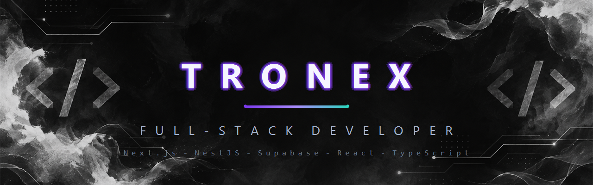
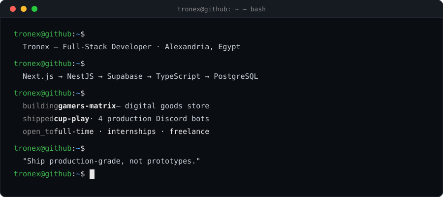
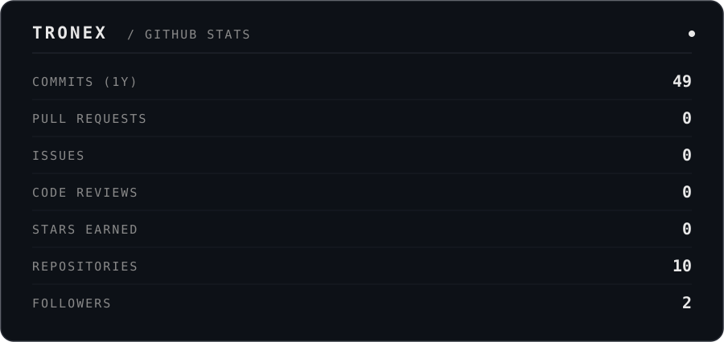
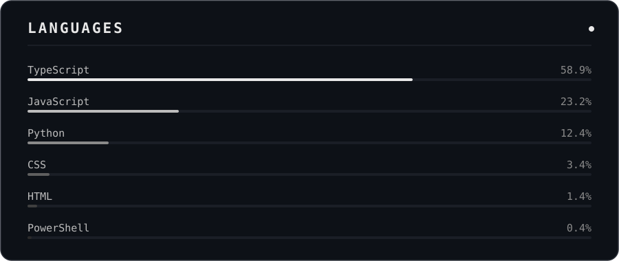

  

  

## ◆ About

  

## ◆ Tech Stack

| | |
|:---|:---|
| 🎨 **Frontend** |      |
| ⚙️ **Backend** |     |
| 🗄️ **Data & Infra** |      |
| 🤖 **Bots & Automation** |      |

## ◆ Featured Projects

| Project | What it does | Stack |
|:---|:---|:---|
| ✂️ **[shrinkjs](https://github.com/MohammedDev69/shrinkjs)** | Deterministic input minimization engine that shrinks JS/TS inputs to the smallest case that still reproduces a bug — CLI, reports & artifacts, published on [npm](https://www.npmjs.com/package/@shrinkjs/core) | `TypeScript` `Node.js` `Delta Debugging` `CLI` |
| 🛒 **[gamers-matrix](https://github.com/MohammedDev69/gamers-matrix)** | Digital goods store (game keys & top-ups) with Paymob payments, RTL Arabic UI and a Turborepo monorepo | `Next.js` `NestJS` `Supabase` `Paymob` |
| 🎮 **[cup-play](https://github.com/MohammedDev69/cup-play)** | Realtime multiplayer party games — imposter, trivia, quick answer & picture guessing — with LiveKit voice rooms, moderation & seasons | `TanStack Start` `Supabase` `LiveKit` |
| 📺 **[discord-yt-sub-verifier](https://github.com/MohammedDev69/discord-yt-sub-verifier)** | Grants verified roles by analyzing subscription screenshots with CV + multilingual OCR and anti-spoofing heuristics | `Python` `OpenCV` `Tesseract` `Docker` |
| 🏅 **[active-developer-badge-bot](https://github.com/MohammedDev69/active-developer-badge-bot)** | Automated Active Developer Badge service — multi-bot runtime manager, ticket claiming & ProBot payment verification | `discord.js` `Node.js` |
| 🛡️ **[discord-word-obfuscator](https://github.com/MohammedDev69/discord-word-obfuscator)** | Keyword obfuscation, auto-moderation with persistent warnings, order tickets & self-roles | `discord.js` `Node.js` |
| 🎡 **[spin-wheel-bot](https://github.com/MohammedDev69/spin-wheel-bot)** | Animated, weighted spin-wheel prize system rendered in real-time with Canvas | `discord.js` `Canvas` |

## ◆ Activity & Stats

  
  

  

  

  <picture>
    <source media="(prefers-color-scheme: dark)" srcset="https://raw.githubusercontent.com/MohammedDev69/MohammedDev69/output/github-contribution-grid-snake-dark.svg"/>
    <source media="(prefers-color-scheme: light)" srcset="https://raw.githubusercontent.com/MohammedDev69/MohammedDev69/output/github-contribution-grid-snake-light.svg"/>
    
  </picture>

## ◆ Connect

**Open to full-stack opportunities, internships & freelance work.**

 

  

  <i>"Build quietly. Ship loudly."</i>

